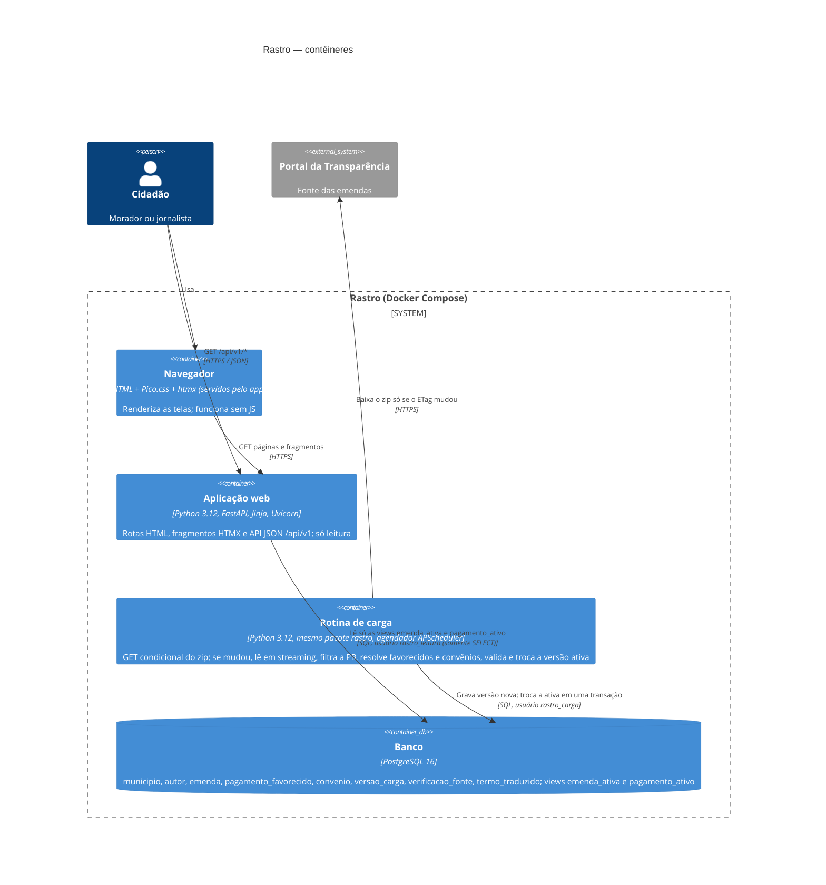
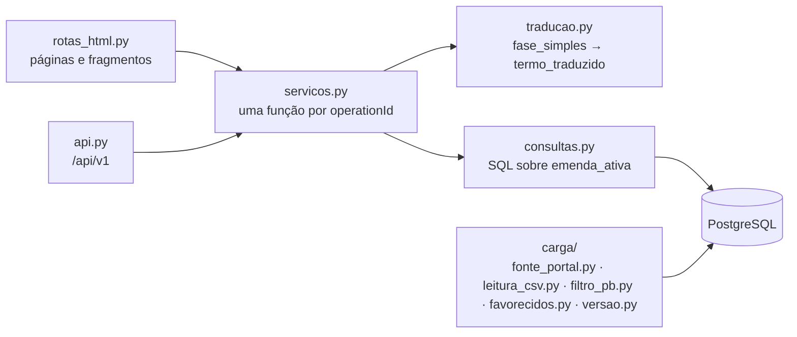

# C4 · Nível 2 — Contêineres (arc42 §5)

## Contêineres

| Contêiner | Tecnologia | Responsabilidade | Contratos | Decisões |
|---|---|---|---|---|
| Navegador | HTML gerado no servidor, Pico.css, htmx (arquivos locais, sem CDN) | Exibir as telas A01–A15; trocar fragmentos sem recarregar a página | `contratos/rotas-html.md` | ADR-0001 |
| Aplicação web | FastAPI + Jinja, Uvicorn com N workers | Atender páginas, fragmentos e a API JSON; aplicar a tradução da fase; nunca escrever no banco | `contratos/openapi.yaml`, `contratos/rotas-html.md` | ADR-0001, ADR-0003, ADR-0004, ADR-0006, ADR-0008, ADR-0009 |
| Rotina de carga | Mesmo pacote Python, processo separado; APScheduler (`BlockingScheduler`) | Executar `verificar_e_carregar` no horário; lock consultivo; validar; ativar a versão; alertar | `contratos/carga.md`, `contratos/fonte-portal.md` | ADR-0002, ADR-0005, ADR-0007 |
| Banco | PostgreSQL 16 (imagem oficial) | Persistência; garantir uma versão ativa (índice único parcial); isolar o leitor pela view | `contratos/modelo-dados.md` | ADR-0002 |

## Componentes da aplicação web (visão rápida, nível 3 parcial)

- `servicos.py` é o ponto único: as rotas HTML e a API chamam a mesma função. Isso garante que todo dado exibido em tela existe no contrato.
- `fonte_portal.py` isola o acesso à fonte (URL, ETag, download); trocar para a API ou para o SIGA só mexe nele. `favorecidos.py` concentra a resolução de município e de categoria (REQ-52, REQ-62).

## Implantação (mínima)

`docker-compose.yml` com três serviços: `web` (porta 8000), `carga` (sem porta; precisa de saída HTTPS para `dadosabertos-download.cgu.gov.br`) e `db` (volume persistente). Variáveis: `FONTE_URL` e `ALERTA_WEBHOOK_URL` (opcional). Hospedagem a definir com o professor (FI §12); o compose roda igual em qualquer máquina com Docker.
