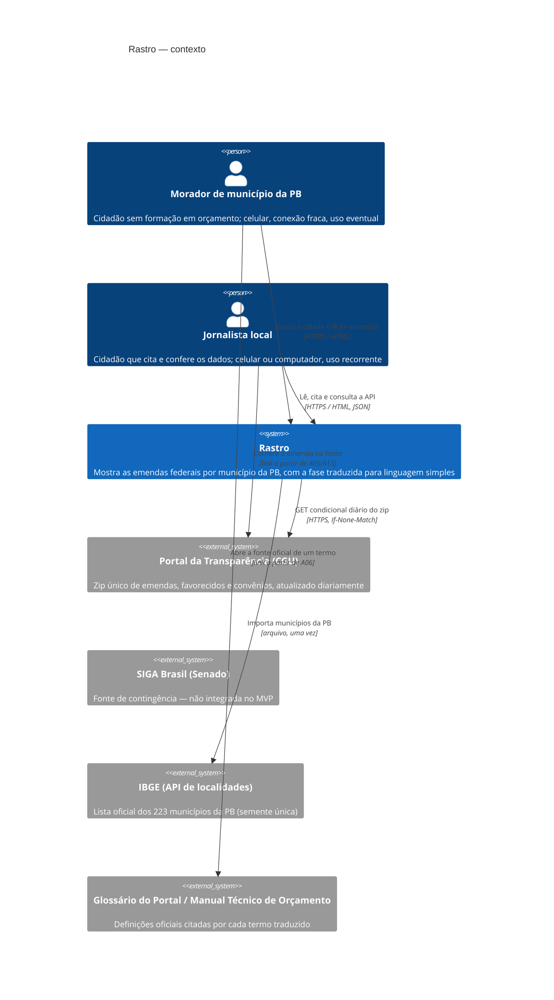

# C4 · Nível 1 — Contexto do sistema (arc42 §3)

## Atores e vizinhos

| Elemento | Tipo | Relação com o Rastro | Telas |
|---|---|---|---|
| Morador | pessoa (cidadão) | usuário principal; sem autenticação | A01–A12, A14, A15 |
| Jornalista | pessoa (cidadão) | mesmas telas + citação, perfis de autores e API | A01–A15, API |
| Rotina de carga | ator não humano **interno** (ver nível 2) | escreve os dados; resultado visível em A10 | A10 |
| Portal da Transparência | sistema externo | fonte dos dados (`contratos/fonte-portal.md`); se cair ou mudar o formato, a carga falha e a versão anterior continua no ar (REQ-35, REQ-48) | — |
| SIGA Brasil | sistema externo | contingência documentada; fora do MVP | — |
| IBGE | sistema externo | lista de municípios, importada uma vez | — |
| Fontes de definição oficial | documentos externos | só são linkados; o Rastro não os copia | A06, A07 |

## Afetados que não são usuários (FI §3.2)
Parlamentares autores e prefeituras não interagem com o sistema, mas suas consequências viram restrição: REQ-15, REQ-18, REQ-27 e REQ-28.

## Fronteira
Dentro: coleta, armazenamento versionado, tradução da fase, telas, API de leitura.
Fora: qualquer escrita por usuários, autenticação, outras UFs, emendas estaduais/municipais, execução física de obras.
