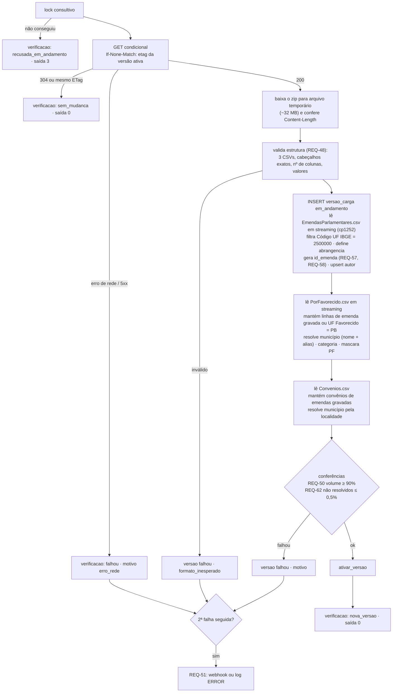

# Contrato da rotina de carga

Ator: **rotina de carga** (não humano). Não tem tela própria; o resultado aparece em A10 · Origem dos dados. O único canal com o resto do sistema é o banco, por isso não há AsyncAPI. O contrato é de comando + efeitos no banco. A fonte está descrita em `fonte-portal.md`.

## `verificar_e_carregar`

| Item | Valor |
|---|---|
| Disparo | Agendador do contêiner `carga` (`0 4 * * *`, America/Recife) ou manual: `python -m rastro.carga executar [--arquivo CAMINHO.zip] [--forcar]` |
| Entrada | Zip de `fonte-portal.md` §1. `--arquivo` usa um zip local (testes e amostra da T1). `--forcar` ignora o ETag. |
| Exclusão mútua | `pg_try_advisory_lock(4242)`. Se não conseguir: grava `verificacao_fonte.resultado='recusada_em_andamento'` e sai com código `3` (REQ-36). |
| Requisitos | REQ-31, 32, 35, 36, 48, 49, 50, 51, 52, 53, 57, 58, 62, 82 |

### Passos



### Leitura dos CSVs
- Decodificar como `cp1252`; usar `csv.reader(delimiter=';', quotechar='"')`.
- Converter valores com `Decimal(s.replace(',', '.'))`, nunca `float`.
- `Sem informação` e `S/I` viram nulo (exceto `autor.id = 'S/I'`).
- Normalizar nomes de município: NFD, remover marcas de acento, maiúsculas, manter `[A-Z ]`, colapsar espaços.

### Saída

| Código | Situação |
|---|---|
| `0` | `nova_versao` ou `sem_mudanca` |
| `1` | falhou (REQ-35) |
| `3` | recusada: há outra carga em andamento |

Relatório JSON (stdout), com os números da T1 como referência:

```json
{
  "resultado": "nova_versao",
  "versao_carga_id": 57,
  "fonte_etag": "\"1b84e550bf57fad7d16f1335bb3391bc-4\"",
  "fonte_last_modified": "2026-10-27T01:44:53Z",
  "total_emendas": 2780,
  "total_por_abrangencia": {"municipal": 1409, "estadual": 454, "multiplo": 917},
  "total_pagamentos": 31515,
  "total_convenios": 1445,
  "total_descartados": 91967,
  "total_sem_codigo": 660,
  "total_codigos_repetidos": 0,
  "total_municipios_nao_resolvidos": 0,
  "duracao_s": 95
}
```

## `ativar_versao(versao_carga_id)`

Uma única transação (`SERIALIZABLE`):

```sql
BEGIN;
UPDATE versao_carga SET ativa = false WHERE ativa;
UPDATE versao_carga SET ativa = true, status = 'concluida', concluida_em = now()
 WHERE id = :nova AND status = 'em_andamento';
COMMIT;
```

- O índice único parcial `WHERE ativa` garante no máximo uma versão ativa. A transação garante que o leitor veja a versão anterior inteira ou a nova inteira (REQ-33, REQ-34).
- A limpeza de versões antigas roda na carga seguinte, para versões ativadas há mais de 24 h (REQ-37).
- Se qualquer passo falhar: `ROLLBACK` e `UPDATE versao_carga SET status='falhou', motivo=…, mensagem_erro=…` (REQ-35).
- Uma versão `em_andamento` órfã (processo morto) é marcada `falhou` com `motivo='erro_interno'` no início da execução seguinte, depois de obtido o lock.
