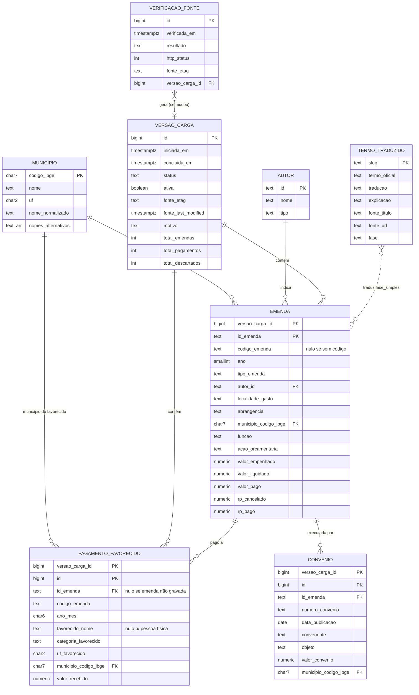

# Modelo de dados — Rastro

Fonte: FI-01 §9, revisado com o arquivo real na T1 (`fonte-portal.md`). Os nomes abaixo são os usados nas fichas de tela (`../../telas/`), no contrato da API (`openapi.yaml`) e no banco (PostgreSQL). **Campos marcados com ✚ não estão no FI-01**; a coluna "Por quê" diz de onde vieram.

## Diagrama



## Entidades

### `municipio`
Semente `data/municipios_pb.csv`, gerada uma vez da API do IBGE (`fonte-portal.md` §6). Não muda a cada carga.

| Campo | Tipo | Regras | Por quê |
|---|---|---|---|
| `codigo_ibge` | `char(7)` PK | 7 dígitos, começa por `25` | URL (REQ-25) |
| `nome` | `text` | nome oficial do IBGE, com acentos | exibição |
| `uf` | `char(2)` | `'PB'` | FI §5 |
| ✚ `nome_normalizado` | `text` | maiúsculas, sem acentos, só letras e espaços; índice `pg_trgm` | busca (REQ-04) e resolução do favorecido (REQ-52) |
| ✚ `nomes_alternativos` | `text[]` | nomes antigos usados pela fonte, normalizados (ex.: `{SERIDO}` em 2515401) | T1: a fonte usa "SERIDÓ" para São Vicente do Seridó |

### `autor`
| Campo | Tipo | Regras | Por quê |
|---|---|---|---|
| `id` | `text` PK | "Código do Autor" da fonte; `S/I` para não informado | estável entre cargas |
| `nome` | `text` | `"Autor não informado na fonte"` quando `S/I` | |
| `tipo` | `text` | `individual` · `bancada` · `comissao` · `relator` · `nao_informado`, derivado de `tipo_emenda` (`fonte-portal.md` §4) | FI §9 |
| ~~`uf_eleicao`~~ | — | **removido**: não existe na fonte (T1) | — |

### `versao_carga`
Criada só quando a fonte mudou (REQ-49).

| Campo | Tipo | Regras | Por quê |
|---|---|---|---|
| `id` | `bigserial` PK | | |
| `iniciada_em`, `concluida_em` | `timestamptz` | `concluida_em` fica nulo até o fim | A10 |
| `status` | `text` | `em_andamento` · `concluida` · `falhou` | FI §9 |
| ✚ `ativa` | `boolean` | índice único parcial `WHERE ativa`; `CHECK (NOT ativa OR status = 'concluida')` | "exatamente uma ativa" como restrição |
| ✚ `fonte_url` | `text` | URL do zip | rastreabilidade |
| ✚ `fonte_etag` | `text` | `ETag` da resposta | REQ-31, REQ-49 |
| ✚ `fonte_last_modified` | `timestamptz` | `Last-Modified` da resposta | rodapé (REQ-03) |
| ✚ `motivo` | `text` | `formato_inesperado` · `queda_de_volume` · `municipios_nao_resolvidos` · `erro_rede` · `erro_interno` (quando `falhou`) | REQ-35, REQ-48, REQ-50, REQ-62 |
| ✚ `mensagem_erro` | `text` | só no banco/log, nunca exibida | REQ-35 |
| `total_emendas` | `int` | linhas gravadas em `emenda` | FI §9 ("total de registros") |
| ✚ `total_por_abrangencia` | `jsonb` | `{"municipal":…, "estadual":…, "multiplo":…}` | A10 |
| ✚ `total_pagamentos` | `int` | linhas em `pagamento_favorecido` | A10 |
| ✚ `total_convenios` | `int` | linhas em `convenio` | A10 |
| ✚ `total_descartados` | `int` | linhas de outras UFs, nacionais ou do exterior | REQ-32 |
| ✚ `total_sem_codigo` | `int` | linhas com `id_emenda` sintético | REQ-57 |
| ✚ `total_codigos_repetidos` | `int` | | REQ-58 |
| ✚ `total_municipios_nao_resolvidos` | `int` | | REQ-62 |

### ✚ `verificacao_fonte`
Uma linha por execução agendada ou manual. É o histórico que A10 mostra (REQ-40) e a base do aviso de REQ-38.

| Campo | Tipo | Regras |
|---|---|---|
| `id` | `bigserial` PK | |
| `verificada_em` | `timestamptz` | |
| `resultado` | `text` | `nova_versao` · `sem_mudanca` · `falhou` · `recusada_em_andamento` |
| `http_status` | `int` | 200, 304… |
| `fonte_etag` | `text` | |
| `versao_carga_id` | `bigint` FK nulo | preenchido quando `nova_versao` ou quando a carga falhou |

### `emenda`
Uma linha da fonte com `Código UF IBGE = 2500000` (REQ-32). Chave primária: `(versao_carga_id, id_emenda)`.

| Campo | Tipo | Regras | Por quê |
|---|---|---|---|
| `versao_carga_id` | `bigint` FK | | ADR-0002 |
| ✚ `id_emenda` | `text` | `codigo_emenda`; `codigo-n` se repetido (REQ-58); `SI-AAAA-xxxxxxxx` se sem código (REQ-57) | T1: 660 linhas da PB sem código |
| `codigo_emenda` | `text` | 12 dígitos ou nulo | |
| `ano` | `smallint` | 2014–… | |
| `tipo_emenda` | `text` | enum de `fonte-portal.md` §4 | |
| ✚ `numero_emenda` | `text` | nulo se `S/I` | citação |
| `autor_id` | `text` FK | | |
| ✚ `localidade_gasto` | `text` | texto original | conferência |
| ✚ `abrangencia` | `text` | `municipal` · `estadual` · `multiplo` | REQ-32 (T1: `MÚLTIPLO` = 917 linhas, R$ 4,8 bi) |
| `municipio_codigo_ibge` | `char(7)` FK | `NOT NULL` se, e somente se, `abrangencia = 'municipal'` (CHECK) | |
| `funcao`, ✚ `subfuncao`, ✚ `programa` | `text` | | |
| ✚ `codigo_acao` | `text` | `0EC2` = transferência especial | REQ-61 |
| `acao_orcamentaria` | `text` | nome da ação | |
| ✚ `plano_orcamentario` | `text` | | REQ-57 |
| `valor_empenhado` | `numeric(15,2)` | | |
| `valor_liquidado` | `numeric(15,2)` | do ano do empenho | |
| `valor_pago` | `numeric(15,2)` | do ano do empenho | |
| ✚ `rp_inscrito` | `numeric(15,2)` | guardado, **não usado em regra** (inconsistente em 61% das linhas) | T1 |
| ✚ `rp_cancelado` | `numeric(15,2)` | | REQ-13, REQ-19 |
| ✚ `rp_pago` | `numeric(15,2)` | pagamentos em anos seguintes | REQ-13, REQ-19 |
| ~~`restos_a_pagar`~~ | — | **substituído** pelos três campos acima | T1 |

Índices: `(versao_carga_id, municipio_codigo_ibge, ano DESC)`; `(versao_carga_id, abrangencia, ano DESC)`; `(versao_carga_id, autor_id)`; `(versao_carga_id, codigo_emenda)`.

### ✚ `pagamento_favorecido`
Uma linha de `EmendasParlamentares_PorFavorecido.csv` que atende REQ-52. Chave: `(versao_carga_id, id)`.

| Campo | Tipo | Regras | Por quê |
|---|---|---|---|
| `id` | `bigserial` | | |
| `id_emenda` | `text` | FK lógica para `emenda` na mesma versão; nulo se a emenda não foi gravada (emenda de fora da PB que pagou entidade da PB) | REQ-54 |
| `codigo_emenda` | `text` | | link para a fonte |
| `ano_mes` | `char(6)` | `AAAAMM` | período (REQ-59) |
| `codigo_favorecido` | `text` | CNPJ; **nulo para pessoa física** | REQ-53 |
| `favorecido_nome` | `text` | **nulo para pessoa física** | REQ-53 |
| `natureza_juridica` | `text` | texto da fonte | |
| `categoria_favorecido` | `text` | tabela abaixo | REQ-52 |
| `uf_favorecido` | `char(2)` | | |
| `municipio_favorecido_nome` | `text` | texto da fonte | conferência |
| `municipio_codigo_ibge` | `char(7)` FK nulo | resolvido pelo nome (REQ-52, REQ-62) | |
| `valor_recebido` | `numeric(15,2)` | | |

Volume esperado por versão: ~31,5 mil linhas (14 893 de emendas da PB + 16 622 de outras emendas com favorecido na PB).

**Regra de `categoria_favorecido`** (aplicada nesta ordem):

| Categoria | Condição |
|---|---|
| `pessoa_fisica` | `Tipo Favorecido` = `Pessoa Fisica` |
| `intermediario_financeiro` | 8 primeiros dígitos do CNPJ ∈ `intermediario_financeiro` (semente: `00000000` Banco do Brasil, `00360305` Caixa) |
| `prefeitura_ou_fundo_municipal` | natureza ∈ {Município, Fundo Público da Administração Direta Municipal, Autarquia Municipal, Fundação Pública de Direito Público Municipal, Órgão Público do Poder Executivo Municipal} |
| `estado` | natureza contém "Estadual ou do Distrito Federal", ou é "Estado ou Distrito Federal" |
| `entidade_privada` | natureza ∈ {Associação Privada, Fundação Privada, Organização Religiosa, Sociedade Empresária Limitada, Sociedade Anônima…, Empresário Individual…} |
| `outro` | demais casos (inclui `Sem informação` e `Inválido`) |

> T1: R$ 1,83 bi de emendas `MÚLTIPLO` da PB foram pagos ao Banco do Brasil (DF). Sem a categoria `intermediario_financeiro`, esse valor seria atribuído ao DF ou a uma "entidade".

### ✚ `convenio`
Uma linha de `EmendasParlamentares_Convenios.csv` cuja emenda foi gravada (REQ-82). Chave: `(versao_carga_id, id)`. Uma emenda pode ter vários convênios, inclusive em municípios diferentes.

| Campo | Tipo | Regras | Por quê |
|---|---|---|---|
| `id` | `bigserial` | | |
| `id_emenda` | `text` | FK lógica para `emenda` na mesma versão | |
| `codigo_emenda` | `text` | | |
| `numero_convenio` | `text` | | citação, conferência |
| `data_publicacao` | `date` | da fonte (`DD/MM/AAAA`) | A05 |
| `convenente` | `text` | quem assinou o convênio | A05 |
| `objeto` | `text` | **texto da fonte, sem reescrita** (REQ-72) | finalidade (REQ-71) |
| `valor_convenio` | `numeric(15,2)` | parte federal; pode diferir do valor da emenda | A05 |
| `localidade_gasto` | `text` | texto original | |
| `municipio_codigo_ibge` | `char(7)` FK nulo | resolvido por `"<MUNICÍPIO> - PB"` | |

Volume esperado: ~1.445 linhas por versão (T1-b).

**Campos derivados (não gravados), na view `emenda_ativa`:**
- `primeiro_ano_mes`: menor `ano_mes` dos pagamentos da emenda; `anos_ate_primeiro_pagamento` = ano dele − `ano` (REQ-74).
- `reserva_antiga_sem_pagamento` = `ano <= extract(year from now()) - 2 AND fase_simples <> 'cancelada' AND valor_pago_total = 0` (REQ-76).

### `termo_traduzido`
| Campo | Tipo | Regras | Por quê |
|---|---|---|---|
| `slug` | `text` PK | | URL (REQ-25) |
| `termo_oficial` | `text` | não nulo | FI §9 |
| `traducao` | `text` | não nulo; ≤ 80 caracteres; passa por REQ-15 | |
| `explicacao` | `text` | não nulo; passa por REQ-15 | |
| `fonte_titulo` | `text` | **não nulo, não vazio** | REQ-16 |
| `fonte_url` | `text` | **não nulo**, `CHECK (fonte_url LIKE 'https://%')` | REQ-16 |
| `fase` | `text` | valor de `fase_simples` traduzido, ou nulo | liga fase → termo |

Conteúdo da tabela, **versão 1 (27/10/2026)**. Cada texto foi escrito a partir da definição oficial indicada, conferida no Glossário do Portal da Transparência, no dicionário de dados das emendas e na Constituição. Todos passam pela lista de REQ-15 e REQ-77, e toda `traducao` tem até 80 caracteres. O que ainda falta é a **validação de compreensão** com 5 pessoas (FI §10.1); os textos podem mudar depois dela sem mudar código, porque ficam em dados (ADR-0003).

| `fase` | `slug` | `termo_oficial` | `traducao` | `explicacao` | `fonte_titulo` · `fonte_url` |
|---|---|---|---|---|---|
| `empenhada` | `empenho` | Empenho | Dinheiro reservado para esta emenda | É o primeiro passo do gasto público: o governo separa o valor no orçamento e assume a obrigação de pagar. Ainda nenhum dinheiro saiu. | Glossário do Portal da Transparência: Empenho · <https://portaldatransparencia.gov.br/glossario> |
| `liquidada` | `liquidacao` | Liquidação | Pagamento autorizado, ainda não feito | É o segundo passo: o governo confere os documentos e reconhece que quem vai receber tem direito ao valor. O dinheiro ainda não saiu. | Glossário do Portal da Transparência: Liquidação · <https://portaldatransparencia.gov.br/glossario> |
| `paga_parcial` | `pagamento-parcial` | Pagamento | Parte do dinheiro já foi paga | Uma parte do valor reservado já saiu do governo federal para quem recebe, e o restante ainda não. A tela mostra quanto falta. | Glossário do Portal da Transparência: Pagamento · <https://portaldatransparencia.gov.br/glossario> |
| `paga` | `pagamento` | Pagamento | Dinheiro pago | É o último passo do gasto público: o dinheiro sai do governo federal para a conta de quem recebe, chamado de favorecido. Os dados mostram até aqui; o uso do dinheiro depois disso não aparece. | Glossário do Portal da Transparência: Pagamento · <https://portaldatransparencia.gov.br/glossario> |
| `cancelada` | `cancelamento` | Restos a pagar cancelados | Reserva cancelada: esse dinheiro não será pago | Parte do valor que ficou para os anos seguintes foi cancelada. Esse valor sai da conta da emenda e não será pago. | Dicionário de dados das Emendas Parlamentares: Valor Restos A Pagar Cancelados · <https://portaldatransparencia.gov.br/dicionario-de-dados/emendas-parlamentares> |
| — | `restos-a-pagar` | Restos a pagar | Pagamento que ficou para os anos seguintes | Quando o dinheiro é reservado num ano e não é pago até 31 de dezembro, o valor passa para os anos seguintes como “restos a pagar”. Por isso uma emenda pode ser paga um, dois ou mais anos depois. | Glossário do Portal da Transparência: Restos a Pagar · <https://portaldatransparencia.gov.br/glossario> |
| — | `transferencia-especial` | Transferência especial | Dinheiro enviado direto ao caixa da prefeitura ou do estado | É um tipo de emenda individual em que o dinheiro vai direto para o município ou o estado, sem convênio. Ao ser transferido, passa a pertencer a quem recebeu; o uso dele depois disso não aparece nos dados federais. | Constituição Federal, art. 166-A (Emenda Constitucional nº 105/2019) · <https://www.planalto.gov.br/ccivil_03/constituicao/constituicao.htm> |
| — | `favorecido` | Favorecido | Quem recebeu o pagamento | Prefeitura, fundo, órgão, empresa, entidade ou pessoa que recebeu o dinheiro. Quando é um banco público, ele só repassa o dinheiro, e o destino final não aparece. | Glossário do Portal da Transparência: Favorecido · <https://portaldatransparencia.gov.br/glossario> |
| — | `convenio` | Convênio | Acordo que diz para que o dinheiro vai ser usado | Acordo entre o governo federal e quem vai usar o dinheiro, como uma prefeitura ou uma entidade. Traz a finalidade (o objeto) e quem assinou. | Glossário do Portal da Transparência: Convênio · <https://portaldatransparencia.gov.br/glossario> |
| — | `objeto-do-convenio` | Objeto do convênio | Para que era o dinheiro, segundo o convênio | É a finalidade escrita no convênio, como uma construção, uma compra de equipamentos ou um serviço. O Rastro mostra o texto como veio da fonte. | Glossário do Portal da Transparência: Objeto do Convênio · <https://portaldatransparencia.gov.br/glossario> |
| — | `emenda-parlamentar` | Emendas Parlamentares | Dinheiro do orçamento federal indicado por parlamentares | É a forma de deputados, senadores, bancadas e comissões indicarem para onde vai uma parte do orçamento federal, como um município ou uma entidade. | Glossário do Portal da Transparência: Emendas Parlamentares · <https://portaldatransparencia.gov.br/glossario> |

Notas:
- A definição oficial de **liquidação** diz que nessa etapa "será cobrada a prestação dos serviços ou a entrega dos bens, ou ainda, a realização da obra". Isso vale para compras diretas do governo. Numa emenda, quem recebe costuma ser a prefeitura ou uma entidade, e os dados não dizem o que foi conferido. Por isso a tradução fica no que é comum aos dois casos: o direito de receber foi reconhecido e o pagamento foi autorizado.
- "Pagamento" e "Pagamento (parcial)" compartilham a fonte; a diferença está só na `traducao`.
- "Sem empenho" saiu da tabela: a fase não existe na fonte (T1).

## View de leitura

```sql
-- toda leitura passa por aqui: nunca enxerga versão em andamento (REQ-34)
CREATE VIEW emenda_ativa AS
SELECT e.*,
       e.valor_empenhado - e.rp_cancelado AS valor_final,
       e.valor_pago + e.rp_pago           AS valor_pago_total,
       CASE
         WHEN e.valor_empenhado - e.rp_cancelado <= 0                         THEN 'cancelada'
         WHEN e.valor_pago + e.rp_pago >= e.valor_empenhado - e.rp_cancelado THEN 'paga'
         WHEN e.valor_pago + e.rp_pago > 0                                     THEN 'paga_parcial'
         WHEN e.valor_liquidado > 0                                            THEN 'liquidada'
         ELSE 'empenhada'
       END AS fase_simples
FROM emenda e
JOIN versao_carga v ON v.id = e.versao_carga_id AND v.ativa;
```

`pagamento_ativo` segue o mesmo padrão. Para URLs com `versao` fixada (REQ-12), a consulta usa `versao_carga_id = :versao` desde que essa versão esteja `concluida` e ainda não tenha sido apagada (REQ-37, REQ-63).

**Validação da regra na T1** (2 780 linhas da PB): `paga` 2 006 · `paga_parcial` 438 · `cancelada` 234 · `empenhada` 100 · `liquidada` 2. Em 93% das emendas com código, `valor_pago_total` é igual à soma recebida pelos favorecidos. A regra anterior, que ignorava `rp_pago`, classificava errado 1 745 linhas (63%).
