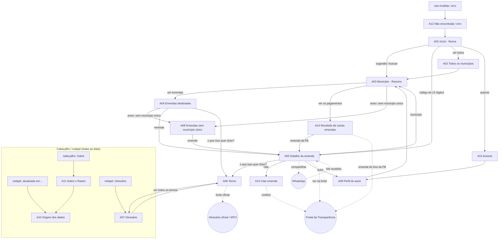

# Inventário e navegação — Rastro

## Atores e superfícies

| Ator | Tipo | Superfície |
|---|---|---|
| Morador (cidadão) | humano, anônimo | **Web pública**: celular primeiro, também desktop |
| Jornalista (cidadão) | humano, anônimo | Web pública + **API JSON pública** (`/api/v1`, sem tela; contrato em `../arquitetura/contratos/openapi.yaml`) |
| Rotina de carga | não humano | **Sem interface própria**: seu resultado é exibido em A10 e no rodapé de todas as telas |

## Quadro de telas

| ID | Tela | Ator | Superfície | Fluxo | MVP? |
|---|---|---|---|---|---|
| A01 | Início · Busca do município | morador, jornalista | web | F1 | sim |
| A02 | Todos os municípios | morador | web | F1 (alternativo) | sim |
| A03 | Município · Resumo | morador, jornalista | web | F1, F2 | sim |
| A04 | Emendas destinadas ao município | morador, jornalista | web | F1, F2 | sim |
| A05 | Detalhe da emenda | morador, jornalista | web | F1, F2, F4 | sim |
| A06 | O que isso quer dizer? (termo) | morador | web | F2 | sim |
| A07 | Glossário | morador, jornalista | web | F2 | sim |
| A08 | Emendas sem município único | morador, jornalista | web | F3 | sim |
| A09 | Perfil do autor da emenda | jornalista, morador | web | F5 | sim |
| A10 | Origem dos dados | jornalista, morador · **rotina de carga** (produz os dados) | web | F6 | sim |
| A11 | Sobre o Rastro | morador, jornalista | web | F6 | sim |
| A12 | Página não encontrada / erro | morador, jornalista | web | infraestrutura | sim |
| A13 | Citar esta emenda | jornalista | web | F4 | sim |
| A14 | Recebido de outras emendas | morador, jornalista | web | F3 | sim |
| A15 | Autores das emendas | morador, jornalista | web | F5 | sim |

15 telas: 13 cobrem fluxos principais e 2 são de infraestrutura e apoio (A11, A12).

## Fluxos

| Fluxo | Pergunta do usuário | Caminho |
|---|---|---|
| **F1 · Encontrar a cidade e entender uma emenda** (principal) | "O que veio para a minha cidade e em que pé está?" | A01 → A03 → A04 → A05 · alternativo: A01 → A02 → A03 |
| **F2 · Entender um termo** | "O que é 'liquidado'?" | A04/A05 → A06 → (fonte oficial externa) · A06 → A07 · rodapé → A07 → A06 |
| **F3 · Ver todo o dinheiro que chegou à cidade** | "Só isso? E as emendas para várias cidades?" | A03 → A14 → A05 · A03/A04 (aviso) → A08 → A05 |
| **F4 · Citar e conferir** (jornalista) | "Como cito isso e onde confiro?" | A01 (código da emenda) → A05 → A13 → (Portal, externo) |
| **F7 · Compartilhar a resposta** | "Quero mandar isso no grupo da família" | A05 → Compartilhar → WhatsApp (externo) → quem recebe abre A05 |
| **F5 · Ver o que um autor indicou** | "O que este parlamentar mandou para a PB?" | A01 → A15 → A09 → A03 · A05 → A09 |
| **F6 · Confiar nos dados** | "De onde vem isso? Está atualizado?" | rodapé (qualquer tela) → A10 · cabeçalho → A11 → A10 |
| **Infra** | — | qualquer rota inválida ou erro → A12 → A01 |

## Mapa de navegação

## Cobertura

| Verificação | Resultado |
|---|---|
| Ator morador aparece | A01–A12, A14, A15 |
| Ator jornalista aparece | A03–A05, A07–A10, A13–A15 (+ API) |
| Ator rotina de carga aparece | A10 (e rodapé de todas) |
| Superfície web | todas |
| Superfície API | mesma operação de cada tela (ver campo *Requisitos · contrato* das fichas) |
| Features do FI-01 | f1 → A10 · f2 → A01, A02 · f3 → A03, A04, A08, A14 · f4 → A05, A06 · f5 → A09, A15 |
